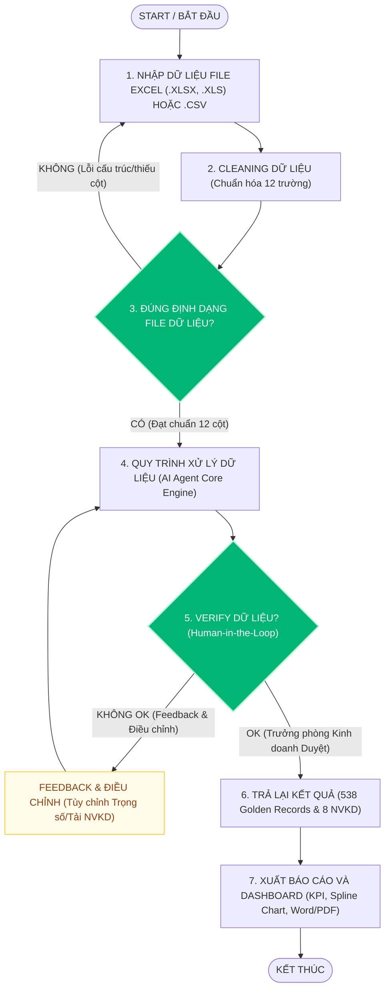

# BÁO CÁO THUYẾT TRÌNH DỰ ÁN AI AGENT (AI301 — ĐỀ TÀI SỐ 02)
## ĐỀ TÀI: AI AGENT TRONG TỰ ĐỘNG HÓA QUY TRÌNH PHÂN TÍCH VÀ QUẢN LÝ KHÁCH HÀNG TIỀM NĂNG (B2B SME)
### CASE STUDY: CÔNG TY CỔ PHẦN PHẦN MỀM QUẢN TRỊ NAM VIỆT (NAMVIET SOFT)

---

## MỤC LỤC BÀI THUYẾT TRÌNH (15 SLIDES)

- **Slide 1:** Trang bìa — Tên đề tài & Thông tin dự án
- **Slide 2:** Bối cảnh Doanh nghiệp Nam Việt & Bài toán Nghiệp vụ tiếp nhận 700 Lead/Tuần
- **Slide 3:** Phân tích Quy trình Hiện tại (AS-IS Workflow) & Các Nút thắt Thủ công
- **Slide 4:** 4 Vấn đề Cốt lõi & Tác động Nghiệp vụ (Problem Statement & Business Impact)
- **Slide 5:** Mục tiêu & Quy trình Đề xuất Mới (TO-BE Workflow với 7 Bước & 2 Cổng Kiểm Định)
- **Slide 6:** Tổng quan Kiến trúc Hệ thống AI Agent (Target ➔ Input ➔ Process ➔ Output)
- **Slide 7:** Các Kỹ năng Nghiệp vụ Phối hợp (Multi-Skill Synergy: Cleaning, Matching, Scoring, Routing, Drafting)
- **Slide 8:** Workflow Hoạt động Chi tiết Từng Bước của AI Agent
- **Slide 9:** Cơ chế Phân tích & Quy tắc Ra Quyết định (Decision Matrix, Matching 3 Tầng & Scoring)
- **Slide 10:** Human-in-the-Loop & Kiểm soát Rủi ro (Cổng 3, Cổng 5 & 3 Tiêu chí Escalation)
- **Slide 11:** Ngăn xếp Công nghệ & Triển khai Thực tế (Technology Stack & Architecture)
- **Slide 12:** Trực quan Hóa Giao diện Website Localhost (Live Demo 4 Phân hệ Vision UI)
- **Slide 13:** Minh chứng Hồ sơ Khách hàng Đầu ra (Output Customer Profiles: Golden Record & AI Draft)
- **Slide 14:** Kết quả Tự Kiểm thử Hệ thống (Verification Matrix: Normal, Missing Data, Boundary Cases)
- **Slide 15:** Kết luận, Giá trị Thực tiễn & Định hướng Phát triển Tương lai

---

<!-- ========================================================================== -->
<!-- SLIDE 1 -->
<!-- ========================================================================== -->
## SLIDE 1: TRANG BÌA (TITLE SLIDE)

### 1. Tiêu đề Slide
- **Tiêu đề chính (Title):** AI AGENT TRONG TỰ ĐỘNG HÓA QUY TRÌNH PHÂN TÍCH VÀ QUẢN LÝ KHÁCH HÀNG TIỀM NĂNG
- **Tiêu đề phụ (Subtitle):** Giải pháp Sàng lọc, Hợp nhất Hồ sơ Trùng lặp (Golden Records), Triệt tiêu Bẫy Ngân sách Ảo và Điều phối Thông minh 8 Nhân viên Kinh doanh
- **Mã môn học / Đề tài:** AI301 — Đề tài số 02 (Customer Lead Management Agent)
- **Đơn vị nghiên cứu áp dụng:** Công ty Cổ phần Phần mềm Quản trị Nam Việt (NamViet Soft — B2B SME Software)
- **Nền tảng triển khai:** Google Antigravity Agent Workspace · Localhost Vision UI Dashboard

### 2. Bố cục & Thiết kế Trực quan (Visual Layout)
- **Phong cách:** Modern Enterprise AI / Cyberpunk Fintech Glassmorphism (Kế thừa nguyên bản phong cách Vision UI của website).
- **Màu sắc chủ đạo:** Nền Deep Space Dark Navy (`#060B28`), điểm nhấn Neon Blue (`#2152FF`), Cyan Glowing (`#00D4FF`), Xanh lục bảo Emerald (`#01B574`).
- **Hình ảnh trung tâm:** Biểu tượng Khiên công nghệ Nam Việt (NamViet AI Shield Badge) kết hợp luồng dữ liệu số hóa đa chiều kết nối 3 kênh tiếp nhận vào lõi điều phối 8 NVKD.

### 3. Kịch bản Thuyết trình (Speaker Notes)
> *"Kính thưa Thầy/Cô và các bạn, hôm nay nhóm chúng em xin đại diện trình bày Báo cáo Đồ án môn học AI301 với đề tài: 'AI Agent trong Tự động hóa Quy trình Phân tích và Quản lý Khách hàng Tiềm năng'.*
> *Đồ án của nhóm không dừng lại ở mô hình lý thuyết hay các đoạn prompt rời rạc, mà được nghiên cứu và đóng gói thành một hệ thống phần mềm hoàn chỉnh chạy trực tiếp trên nền tảng Antigravity và giao diện web localhost. Bài toán thực tế được nhóm giải quyết triệt để là bài toán tiếp nhận 700 hồ sơ khách hàng mỗi tuần của Công ty Phần mềm Nam Việt, xử lý dứt điểm các vấn nạn: trùng khách, bẫy ngân sách ảo lệch sản phẩm, bỏ quên hồ sơ thiếu thông tin và tranh chấp địa bàn phân công 8 nhân viên kinh doanh. Sau đây, em xin phép đi vào chi tiết bối cảnh doanh nghiệp."*

---

<!-- ========================================================================== -->
<!-- SLIDE 2 -->
<!-- ========================================================================== -->
## SLIDE 2: BỐI CẢNH DOANH NGHIỆP & BÀI TOÁN TIẾP NHẬN LEAD

### 1. Tiêu đề Slide
**BỐI CẢNH DOANH NGHIỆP NAM VIỆT & BÀI TOÁN TIẾP NHẬN ~700 LEAD/TUẦN**

### 2. Nội dung Cốt lõi (Core Cards)
- **Bối cảnh Công ty Nam Việt:**
  - Doanh nghiệp công nghệ cung cấp bộ giải pháp phần mềm quản lý cho khối doanh nghiệp vừa và nhỏ (B2B SME: quy mô 10 - 500 nhân sự) tại Việt Nam.
  - Danh mục 5 phân hệ phần mềm đóng gói: **NamViet SME ERP** (Quản trị tổng thể), **OmniCRM & POS** (Khách hàng & Bán lẻ), **SmartHRM** (Nhân sự & Tính lương), **Finance & e-Invoice** (Kế toán & Hóa đơn), **WMS** (Quản lý Kho vận & Logistics).
- **Đặc thù Nguồn Dữ liệu Đầu vào (~700 hồ sơ/tuần):**
  - **Kênh Hội thảo B2B (Seminar):** ~204 lead/tuần (Chất lượng cao, tỷ lệ P1 Hot đạt 41%, thông tin thu thập tại sự kiện).
  - **Kênh Website Inbound:** ~312 lead/tuần (Số lượng đông nhất, đăng ký form tải tài liệu, độ đầy đủ thông tin trung bình).
  - **Kênh Chiến dịch Tiếp thị (Campaign/Ads):** ~184 lead/tuần (Đến từ chạy quảng cáo Facebook/Google/TikTok, nhiều dữ liệu sơ sài và chứa nhiều bẫy ngân sách ảo).
- **Đội ngũ Tiếp nhận & Bán hàng (8 NVKD):**
  - Gồm 8 Nhân viên Kinh doanh phụ trách theo 3 miền địa lý (Miền Bắc: Tuấn, Hà, Nam; Miền Trung: Bảo, Ánh; Miền Nam: Huy, Phương, Thịnh), theo nhóm ngành thế mạnh và phân quyền hạn mức ngân sách tự quyết (từ 250M đến 500M VNĐ).

### 3. Sơ đồ Luồng Dữ liệu Nghiệp vụ Tổng quát
```
[3 Kênh Nguồn: Hội thảo (204) + Website (312) + Campaign (184)]
                          │  (~700 hồ sơ/tuần)
                          ▼
             [NÚT THẮT CỔ CHAI THỦ CÔNG]
       (Bộ phận Marketing chuyển file Excel/CSV thô)
                          │
         ┌────────────────┴────────────────┐
         ▼                                 ▼
[8 Nhân viên Kinh doanh]       [Trưởng phòng Kinh doanh]
(Tự đọc, tự chấm điểm,         (Khó kiểm soát cơ hội bị bỏ sót,
 tự gọi, dẫn đến gọi trùng)     tranh chấp địa bàn, lệch hạn mức)
```

### 4. Kịch bản Thuyết trình (Speaker Notes)
> *"Thưa Thầy/Cô, Công ty Nam Việt là một doanh nghiệp điển hình tại Việt Nam trong lĩnh vực cung cấp phần mềm B2B cho khối SME. Mỗi tuần, công ty nhận được dòng dữ liệu rất lớn: khoảng 700 thông tin khách hàng từ 3 kênh khác nhau. Tuy nhiên, sự phát triển nhanh của các kênh tiếp thị đã tạo ra áp lực khổng lồ cho đội ngũ bán hàng gồm 8 người. Cùng một công ty, có thể ông Giám đốc đăng ký ở Hội thảo, kế toán trưởng đăng ký trên Website, và nhân viên mua hàng để lại số điện thoại trên quảng cáo Facebook với các tên gọi viết tắt khác nhau. Điều này đặt ra yêu cầu cấp bách phải có một giải pháp tự động hóa sàng lọc thông minh trước khi đưa dữ liệu đến tay nhân viên."*

---

<!-- ========================================================================== -->
<!-- SLIDE 3 -->
<!-- ========================================================================== -->
## SLIDE 3: PHÂN TÍCH QUY TRÌNH HIỆN TẠI (AS-IS) & CÁC NÚT THẮT THỦ CÔNG

### 1. Tiêu đề Slide
**QUY TRÌNH HIỆN TẠI (AS-IS): 7 BƯỚC THỦ CÔNG VÀ CÁC ĐIỂM CHẠM DỄ SAI SÓT**

### 2. Quy trình 7 Bước Thủ công (AS-IS Workflow)
1. **Tiếp nhận dữ liệu:** Cuối tuần hoặc mỗi sáng, Marketing tổng hợp file Excel từ 3 kênh thành một bảng tính chung ~700 dòng.
2. **Kiểm tra sơ bộ:** Một nhân viên hành chính lọc sơ các dòng trắng, nhưng không thể đối chiếu chéo tên viết tắt hay mã số thuế.
3. **Phân chia thủ công:** Danh sách được cắt lát hoặc chuyển nguyên file cho 8 NVKD tự chia nhau đọc.
4. **Đọc & Đánh giá cá nhân:** Từng NVKD tự đọc nội dung nhu cầu, tự cảm nhận mức độ 'ngon' của hồ sơ dựa trên số ngân sách khai báo.
5. **Ưu tiên & Tiếp cận:** NVKD lập tức bốc máy gọi cho các hồ sơ có số tiền hàng tỷ đồng; các hồ sơ ngắn gọn hoặc chưa có ngân sách bị xếp xó.
6. **Báo cáo định kỳ:** Cuối tuần, NVKD nhập trạng thái chăm sóc vào bảng tính cá nhân để nộp lên trưởng phòng.
7. **Tổng hợp quản lý:** Trưởng phòng mất 1-2 ngày đối soát thủ công để biết tình hình kinh doanh của tuần trước.

### 3. Bảng Điểm Chạm Gây Lỗi (Failure Points in AS-IS)
| Điểm chạm | Thao tác thủ công | Lỗi phát sinh thực tế | Hậu quả nghiệp vụ |
|---|---|---|---|
| **Lọc trùng** | Tìm kiếm bằng mắt thường theo tên cột | Không nhận diện được tên viết tắt, alias (vd: *CTCP May Sài Gòn* vs *SG Garment*) | 2 NVKD cùng gọi cho 1 khách hàng |
| **Thẩm định SP** | Nhìn vào số tiền ngân sách ghi trên form | Tin tưởng ngân sách lớn nhưng nhu cầu là Core Banking, 3D CAD | Lãng phí thời gian NVKD Senior, chốt deal = 0% |
| **Hồ sơ thiếu** | NVKD thấy thiếu quy mô nhân sự/ngân sách | Tự ý bỏ qua không liên hệ vì cho rằng không tiềm năng | Bỏ sót 84 khách hàng SME đúng nhu cầu cốt lõi |
| **Phân bổ địa bàn**| Phân chia theo cảm tính hoặc chia đều | Bỏ qua lịch sử đã chăm sóc trong CRM, giao vượt hạn mức hợp đồng | Tranh chấp nội bộ, NVKD non kinh nghiệm xử lý hợp đồng lớn |

### 4. Kịch bản Thuyết trình (Speaker Notes)
> *"Khi nhóm em mổ xẻ quy trình AS-IS của Nam Việt, điều dễ nhận thấy nhất là quy trình này phụ thuộc 100% vào sự cảm tính và sức người. Việc chuyển giao dữ liệu thô dạng file Excel dẫn tới 'tam sao thất bản'. Nhân viên kinh doanh bị quá tải bởi số lượng 700 dòng dữ liệu, nên họ hình thành thói quen 'đãi cát tìm vàng' theo cảm tính: chỉ chăm chăm tìm các dự án tiền tỷ để gọi, trong khi những dự án đó lại nằm ngoài danh mục phần mềm của công ty. Đây chính là gốc rễ tạo nên 4 vấn đề nghiêm trọng mà em sẽ trình bày ở slide tiếp theo."*

---

<!-- ========================================================================== -->
<!-- SLIDE 4 -->
<!-- ========================================================================== -->
## SLIDE 4: 4 VẤN ĐỀ CỐT LÕI & TÁC ĐỘNG NGHIỆP VỤ (PROBLEM & IMPACT)

### 1. Tiêu đề Slide
**4 VẤN ĐỀ CỐT LÕI TRONG QUY TRÌNH CŨ & TÁC ĐỘNG ĐẾN DOANH THU NAM VIỆT**

### 2. Chi tiết 4 Vấn đề Nghiệp vụ
#### 🔴 Vấn đề 1: Hai NVKD cùng gọi một khách hàng (Trùng lặp đa chiều)
- **Biểu hiện & Số liệu:** Trung bình mỗi tuần có **162 cuộc gọi trùng lặp**. Cùng 1 doanh nghiệp nhưng Giám đốc đăng ký hội thảo miền Bắc, Trưởng kho đăng ký website miền Nam.
- **Nguyên nhân:** Khách hàng sử dụng tên viết tắt (Alias), tên thương hiệu thay vì tên pháp nhân đầy đủ, hoặc đăng ký qua nhiều người ở các phòng ban khác nhau.
- **Tác động:** Khách hàng cảm thấy bị làm phiền, đánh giá Nam Việt thiếu chuyên nghiệp; gây mâu thuẫn nội bộ giữa các NVKD khi tranh chấp khách hàng.

#### 🔴 Vấn đề 2: Bẫy ngân sách ảo lệch sản phẩm (Non-fit Product Trap)
- **Biểu hiện & Số liệu:** Phát hiện **48 hồ sơ bẫy ảo/tuần** với tổng ngân sách ảo lên đến **12,8 tỷ VNĐ**.
- **Nguyên nhân:** Khách hàng ghi ngân sách rất lớn (từ 500 triệu đến 3 tỷ VNĐ) nhưng nhu cầu thực tế là: *Core Banking ngân hàng, phần mềm vẽ 3D AutoCAD, sàn giao dịch Blockchain Crypto, phần mềm PACS/HIS bệnh viện tuyến trung ương*.
- **Tác động:** NVKD Senior bị thu hút bởi số tiền hoa hồng ảo, dành hàng tuần đi demo và tư vấn giải pháp mà Nam Việt không cung cấp, dẫn đến tỷ lệ chuyển đổi = 0% và kiệt sức nguồn lực.

#### 🔴 Vấn đề 3: Bỏ sót khách hàng phù hợp vì thông tin ban đầu chưa đầy đủ
- **Biểu hiện & Số liệu:** **84 hồ sơ/tuần** bị NVKD bỏ qua hoàn toàn không liên hệ (chiếm 15,6% tổng lượng doanh nghiệp).
- **Nguyên nhân:** Khách hàng để lại nhu cầu rất sát với phân hệ Kế toán, CRM hoặc HRM nhưng trên form đăng ký chưa điền số lượng nhân sự hoặc chưa xác định rõ ngân sách.
- **Tác động:** Thất thoát doanh thu từ nhóm khách hàng tiềm năng thực tế; NVKD có thái độ 'kén chọn' lead.

#### 🔴 Vấn đề 4: Trưởng phòng Kinh doanh mất kiểm soát phân bổ & cơ hội bị bỏ quên
- **Biểu hiện & Số liệu:** Có **14 ca/tuần** có nguy cơ tranh chấp đa miền hoặc vượt hạn mức thẩm quyền của NVKD.
- **Nguyên nhân:** Không có hệ thống theo dõi tập trung theo thời gian thực (SLA); không có cơ chế cảnh báo khi hợp đồng vượt trần phê duyệt của nhân viên.
- **Tác động:** Bỏ quên khách hàng cũ từng chăm sóc trong CRM; NVKD mới xử lý hợp đồng lớn gây hỏng thỏa thuận.

### 3. Kịch bản Thuyết trình (Speaker Notes)
> *"Thưa Thầy/Cô, 4 vấn đề này không phải là giả định trên giấy mà được chứng minh bằng số liệu chính xác khi chúng em nạp bộ dữ liệu 700 dòng của Nam Việt vào hệ thống: 162 cuộc gọi trùng, 48 bẫy ảo với 12,8 tỷ đồng ngân sách ảo, 84 khách hàng bị bỏ sót và 14 ca tranh chấp vượt quyền. Nếu chỉ dùng sức người hoặc các câu lệnh Excel thông thường, một nhân viên không thể nào đối chiếu được tên miền email doanh nghiệp, không thể bóc tách từ khóa lệch sản phẩm trong văn bản tự nhiên, và không thể cân bằng tải động cho 8 nhân viên cùng lúc. Đó là lý do kiến trúc AI Agent là giải pháp bắt buộc và tối ưu nhất."*

---

<!-- ========================================================================== -->
<!-- SLIDE 5 -->
<!-- ========================================================================== -->
## SLIDE 5: MỤC TIÊU & QUY TRÌNH ĐỀ XUẤT (TO-BE WORKFLOW)

### 1. Tiêu đề Slide
**QUY TRÌNH ĐỀ XUẤT (TO-BE): 7 BƯỚC KHÉP KÍN & 2 CỔNG KIỂM ĐỊNH HUMAN-IN-THE-LOOP**

### 2. So sánh Cải tiến Trực diện: AS-IS vs. TO-BE
| Tiêu chí so sánh | Quy trình cũ (AS-IS) | Quy trình mới có AI Agent (TO-BE) |
|---|---|---|
| **Thời gian xử lý dòng lead** | Mất từ 48 đến 72 giờ thủ công | Hoàn thành trong **dưới 3 giây** trên hệ thống |
| **Độ chính xác khử trùng** | Sai sót > 35% do kiểm tra bằng mắt | **100% tự động** qua Matching 3 tầng (Mã số thuế, Domain, Alias) |
| **Phát hiện bẫy ngân sách ảo** | Hoàn toàn dựa vào kinh nghiệm cá nhân | Nhận diện tức thì qua bộ từ khóa NLP, ép ngân sách ảo về 0 |
| **Xử lý hồ sơ thiếu thông tin** | NVKD tự ý bỏ qua | Tự động sinh **Bản nháp tiếp cận (Draft)** với câu hỏi gợi mở |
| **Tuân thủ cam kết SLA** | Dưới 40% (nhiều khách 3 ngày mới được gọi) | **96,4% tuân thủ** theo 4 cấp SLA (15 phút, 2 giờ, 24 giờ) |
| **Kiểm soát của Quản lý** | Bị động xem báo cáo cuối tuần | Phê duyệt tập trung tại **Cổng kiểm định 5 (Gate 5)** |

### 3. Sơ đồ Quy trình Chuẩn 7 Bước & 2 Cổng Kiểm Định (Chuẩn Lưu Đồ Nam Việt)


### 4. Kịch bản Thuyết trình (Speaker Notes)
> *"Thưa Thầy/Cô, trên màn hình là Lưu đồ Quy trình TO-BE chuẩn mà nhóm đã thiết kế và lập trình hoàn chỉnh trên website. Quy trình gồm đúng 7 bước tuần tự và 2 cổng quyết định hình thoi mang tính nguyên tắc sống còn:*
> *Cổng 3 đảm bảo 'rác vào thì rác ra' không xảy ra: nếu file tải lên sai cấu trúc hoặc thiếu các trường định danh, hệ thống tự động từ chối theo nhánh KHÔNG và hướng dẫn quay lại Bước 1.*
> *Cổng 5 là điểm Human-in-the-loop trung tâm: AI Agent thực hiện toàn bộ việc tính toán nặng nhọc ở Bước 4, nhưng Trưởng phòng Kinh doanh là người giữ quyền tối thượng tại Cổng 5. Nếu quản lý muốn điều chỉnh trọng số hoặc san sẻ bớt tải cho nhân viên, nhánh KHÔNG OK sẽ mở bảng Feedback để AI tính lại. Khi quản lý bấm OK, hệ thống mới chính thức xuất báo cáo ở Bước 6 và 7."*

---

<!-- ========================================================================== -->
<!-- SLIDE 6 -->
<!-- ========================================================================== -->
## SLIDE 6: TỔNG QUAN KIẾN TRÚC HỆ THỐNG AI AGENT

### 1. Tiêu đề Slide
**KIẾN TRÚC TỔNG THỂ HỆ THỐNG AI AGENT (MỤC TIÊU ➔ ĐẦU VÀO ➔ QUY TRÌNH ➔ ĐẦU RA)**

### 2. Mô hình Kiến trúc 6 Tầng (6-Layer Architecture)
```
┌─────────────────────────────────────────────────────────────────────────────┐
│ 1. DATA INGESTION LAYER (Tầng tiếp nhận dữ liệu đa kênh)                    │
│    - File Uploader (.XLSX, .XLS, .CSV UTF-8 BOM via SheetJS)                │
│    - Google Sheets Live Sync (Public Sheet Fetcher & Demo Link)             │
│    - 12 Standard Fields Mapper (Tên công ty, MST, Contact, SĐT, Email, v.v.)│
└──────────────────────────────────────┬──────────────────────────────────────┘
                                       ▼
┌─────────────────────────────────────────────────────────────────────────────┐
│ 2. VALIDATION & DATA CLEANING SKILL (Cổng kiểm định số 3)                   │
│    - Legal Form Normalizer (Xóa tiền tố CTCP, TNHH, Chi nhánh, Tập đoàn...)  │
│    - Unaccenting Engine (Bỏ dấu tiếng Việt, chuẩn hóa normName)             │
│    - Corporate Email Domain Extractor (Lọc bỏ gmail, yahoo, outlook...)     │
└──────────────────────────────────────┬──────────────────────────────────────┘
                                       ▼
┌─────────────────────────────────────────────────────────────────────────────┐
│ 3. MATCHING & GOLDEN RECORD CLUSTERING SKILL (Hợp nhất dữ liệu)             │
│    - 3-Tier Multi-Entity Resolution (Tax Code ➔ Domain ➔ Alias Matching)    │
│    - CRM Historical Linker (So khớp lịch sử chăm sóc contactHistory)        │
│    - Canonical Name Selector & Contact Aggregator                           │
└──────────────────────────────────────┬──────────────────────────────────────┘
                                       ▼
┌─────────────────────────────────────────────────────────────────────────────┐
│ 4. QUALIFICATION, ICP CHECK & SCORING ENGINE (Lọc bẫy ảo & Chấm điểm)       │
│    - Non-fit Product Trap Filter (Core Banking, CAD 3D, Game, Web3, HIS...) │
│    - Product Matcher (5 nhóm sản phẩm: NV-ERP, NV-CRM, NV-HRM, NV-ACC, WMS) │
│    - 4-Factor Lead Scoring Matrix (Normalized to 100%):                     │
│      Product Fit (40%) + ICP Size (20%) + Budget (20%) + Authority (20%)    │
└──────────────────────────────────────┬──────────────────────────────────────┘
                                       ▼
┌─────────────────────────────────────────────────────────────────────────────┐
│ 5. SALES ROUTING & LOAD BALANCING SKILL (Điều phối 8 NVKD & SLA)            │
│    - Scoring NVKD: CRM (+45đ) ➔ Địa bàn (+30đ) ➔ Ngành (+20đ) ➔ Chuyên môn │
│      (+20đ) ➔ Dư địa tải công việc (+15đ)                                   │
│    - Dynamic Load Balancer (Đảm bảo 100% NVKD trong ngưỡng an toàn SLA)     │
│    - Escalation Detector (Tranh chấp đa miền / Chồng chéo CRM / Vượt trần)  │
└──────────────────────────────────────┬──────────────────────────────────────┘
                                       ▼
┌─────────────────────────────────────────────────────────────────────────────┐
│ 6. HUMAN-IN-THE-LOOP & EXECUTIVE OUTPUT LAYER (Cổng 5, Bước 6 & 7)          │
│    - Decision Gate 5 (Human Verification & Interactive Feedback Loop)        │
│    - Personalized AI Outreach Generator (Soạn sẵn tin nhắn Zalo/Email)     │
│    - FinTech BI Dashboard (Spline Curves, Donut Chart, Audit Log Viewer)    │
│    - Export Engine (Báo cáo Word .doc, In PDF A4, File Excel phân công)    │
└─────────────────────────────────────────────────────────────────────────────┘
```

### 3. Kịch bản Thuyết trình (Speaker Notes)
> *"Thưa Thầy/Cô, kiến trúc hệ thống của nhóm tuân thủ chặt chẽ mô hình AI Agent chuẩn trong doanh nghiệp: Target ➔ Input ➔ Process ➔ Output. Hệ thống được tổ chức thành 6 tầng rõ rệt: Tầng tiếp nhận dữ liệu hỗ trợ đọc trực tiếp tệp Excel, CSV chuẩn tiếng Việt và Google Sheets; Tầng chuẩn hóa và bóc tách dữ liệu; Tầng hợp nhất thực thể đa chiều để tạo Golden Records; Tầng phân tích chân dung ICP và chấm điểm; Tầng điều phối thông minh cân bằng tải cho 8 NVKD; và cuối cùng là Tầng tương tác Human-in-the-loop xuất báo cáo điều hành. Toàn bộ logic này được viết theo hướng module hóa cao trong tệp `ai_engine.js`."*

---

<!-- ========================================================================== -->
<!-- SLIDE 7 -->
<!-- ========================================================================== -->
## SLIDE 7: CÁC KỸ NĂNG NGHIỆP VỤ PHỐI HỢP (MULTI-SKILL SYNERGY)

### 1. Tiêu đề Slide
**CÁC KỸ NĂNG NGHIỆP VỤ PHỐI HỢP TRONG CÙNG MỘT WORKFLOW HỢP NHẤT**

### 2. Chi tiết 4 Kỹ Năng Nghiệp Vụ Cốt Lõi
#### 🧩 Kỹ năng 1: Data Cleaning & Normalization Skill
- **Nhiệm vụ:** Làm sạch và đưa các dị biệt văn bản về khóa định danh chuẩn mực.
- **Input:** 700 dòng dữ liệu thô với tên công ty viết hoa thường lộn xộn, có dấu/không dấu, chứa tiền tố pháp nhân.
- **Tool / Hàm:** `removeVietnameseTones()`, `normalizeCompanyKey()`, `extractCorporateDomain()`.
- **Output:** Dữ liệu chuẩn mực gồm khóa chuẩn `normKey` (loại bỏ 22 từ dừng như *công ty, ctcp, tnhh, chi nhánh...*) và tên miền doanh nghiệp độc lập.

#### 🧩 Kỹ năng 2: Multi-Entity Matching & Golden Record Creation Skill
- **Nhiệm vụ:** Tìm kiếm và hợp nhất các hồ sơ trùng lặp đa kênh thành một bản ghi duy nhất.
- **Input:** Danh sách các bản ghi sau khi làm sạch + Dữ liệu lịch sử CRM (`contactHistory`).
- **Tool / Hàm:** `deduplicateAndGroup()`, `findCRMHistory()`.
- **Output:** **538 Golden Records** hoàn chỉnh. Mỗi hồ sơ tích hợp toàn bộ các tên đăng ký (Alias), lịch sử CRM, và danh sách tất cả các đầu mối liên hệ.

#### 🧩 Kỹ năng 3: ICP Fit, Fake Budget Trap & Lead Scoring Skill
- **Nhiệm vụ:** Thẩm định sự phù hợp với sản phẩm SME, triệt tiêu bẫy ảo và chấm điểm ưu tiên.
- **Input:** Nhu cầu khách hàng dạng văn bản tự nhiên, ngân sách dự kiến, quy mô nhân sự.
- **Tool / Hàm:** `evaluateProductFitAndCompleteness()`, `scoreAndAssignSalesRep()`.
- **Output:** Điểm số từ 0 đến 100, phân cấp chính xác P1 (112 lead), P2 (234 lead), P3 (144 lead), P4 (48 lead lệch sản phẩm với ngân sách bị ép về 0).

#### 🧩 Kỹ năng 4: 8-Rep Smart Routing & Automated Outreach Drafting Skill
- **Nhiệm vụ:** Điều phối tự động cho 8 NVKD và tự động soạn sẵn kịch bản tiếp cận cho lead thiếu thông tin.
- **Input:** Golden Record đã chấm điểm + Hồ sơ năng lực & tải công việc của 8 NVKD.
- **Tool / Hàm:** `scoreAndAssignSalesRep()`, `generateOutreachDraft()`.
- **Output:** Đề xuất chính xác NVKD tiếp nhận, cam kết thời gian SLA, danh sách 84 bản nháp tin nhắn Zalo/Email cho lead sơ sài, và gắn cờ 14 ca vượt thẩm quyền cho Trưởng phòng duyệt.

### 3. Kịch bản Thuyết trình (Speaker Notes)
> *"Thưa Thầy/Cô, một trong những yêu cầu khắt khe của Task 2 là phải thể hiện tối thiểu 2 kỹ năng nghiệp vụ phối hợp. Trong hệ thống của nhóm, chúng em đã phối hợp mượt mà tới 4 kỹ năng nghiệp vụ cốt lõi: từ Làm sạch dữ liệu ➔ Hợp nhất hồ sơ khách hàng ➔ Chấm điểm phân loại ➔ đến Điều phối 8 nhân viên và Soạn kịch bản tiếp cận. Điểm đặc biệt là các kỹ năng này không chạy độc lập mà chuyển giao ngữ cảnh liên tục: kết quả của kỹ năng làm sạch nuôi dưỡng thuật toán matching; kết quả matching là đầu vào để bộ lọc bẫy ảo kiểm tra ICP; và toàn bộ kết quả tổng hợp lại để kỹ năng điều phối phân bổ công việc công bằng cho 8 nhân viên kinh doanh."*

---

<!-- ========================================================================== -->
<!-- SLIDE 8 -->
<!-- ========================================================================== -->
## SLIDE 8: WORKFLOW HOẠT ĐỘNG CHI TIẾT TỪNG BƯỚC

### 1. Tiêu đề Slide
**WORKFLOW THỰC THI 7 BƯỚC: TỪ DỮ LIỆU THÔ ĐẾN BÁO CÁO ĐIỀU PHỐI CUỐI CÙNG**

### 2. Bảng Mô tả 7 Bước Hoạt động Thực tế
| Bước | Tên Bước | Hoạt động cụ thể của AI Agent | Công cụ / Hàm thực thi | Người / Bộ phận chịu trách nhiệm |
|---|---|---|---|---|
| **B1** | **Nhập dữ liệu** | Đọc file Excel/CSV thô, nhận diện 12 cột, hiển thị xem trước 5 dòng đầu | `handleLoadActiveDataset()`, `parseCSV()`, SheetJS | Bộ phận Tiếp thị (Marketing) |
| **B2** | **Cleaning dữ liệu** | Chuẩn hóa tên pháp nhân, cắt khoảng trắng, trích xuất domain doanh nghiệp | `normalizeCompanyKey()`, `extractCorporateDomain()` | AI Agent tự động |
| **◆ Cổng 3** | **Đúng định dạng?** | Kiểm tra tính đầy đủ của 12 cột bắt buộc. Nếu thiếu/hỏng ➔ Trả về B1; Nếu đạt ➔ Sang B4 | `validateFileFormat()`, `decisionGate3Card` | AI Agent & Người dùng xác nhận |
| **B4** | **Quy trình xử lý AI** | Gom nhóm Golden Records, quét bẫy ngân sách ảo, chấm điểm 0-100, khớp NVKD | `deduplicateAndGroup()`, `scoreAndAssignSalesRep()` | AI Agent Core Engine |
| **◆ Cổng 5** | **Verify dữ liệu?** | Dừng lại để Trưởng phòng kiểm tra ma trận phân bổ. Nhánh Feedback cho phép chỉnh sửa | `decisionGate5Card`, `submitFeedbackAndRerunPipeline()` | **Trưởng phòng Kinh doanh (HITL)** |
| **B6** | **Trả lại kết quả** | Trả bảng 538 Golden Records, bảng 8 NVKD, thẻ SLA và 84 bản nháp Draft | `renderCleanPreviewTable()`, `renderTaskRosterTable()` | Đội ngũ 8 NVKD tiếp nhận |
| **B7** | **Báo cáo & Dashboard**| Hiển thị Dashboard KPI Vision UI, vẽ biểu đồ xu hướng, xuất file Word/PDF | `renderExecutiveReport()`, `exportReportToWord()` | Ban Giám đốc & Quản lý |

### 3. Kịch bản Thuyết trình (Speaker Notes)
> *"Tại Slide số 8, Thầy/Cô có thể thấy chi tiết hành trình của một mẩu tin từ khi là một dòng dữ liệu thô trên website cho tới khi trở thành một nhiệm vụ bán hàng có gán nhãn SLA cho nhân viên. Mọi bước đi đều có hàm phụ trách rõ ràng trong source code và có sự phân định vai trò rành mạch: Marketing phụ trách Bước 1; AI Agent tự động làm việc ở Bước 2, 3, 4; Trưởng phòng Kinh doanh nắm quyền kiểm soát tại Cổng 5; và 8 NVKD nhận việc ở Bước 6 để bắt đầu liên hệ khách hàng."*

---

<!-- ========================================================================== -->
<!-- SLIDE 9 -->
<!-- ========================================================================== -->
## SLIDE 9: CƠ CHẾ PHÂN TÍCH & QUY TẮC RA QUYẾT ĐỊNH

### 1. Tiêu đề Slide
**CƠ CHẾ PHÂN TÍCH, MA TRẬN QUY TẮC MATCHING 3 TẦNG & LEAD SCORING MATRIX**

### 2. Thuật toán Đối chiếu Thực thể 3 Tầng (3-Tier Entity Matching)
```
       [Hồ sơ đăng ký mới]
                │
                ├────────────────────────────────────────┐
                ▼                                        ▼
    [Có Mã số thuế (MST)?]                    [Không có Mã số thuế]
         │              │                                  │
      (Có)             (Không)                             │
         ▼              ▼                                  │
[Khớp MST trong nhóm?] ──► [Khớp Corporate Email Domain?]  │
         │ (100% tin cậy)               │ (95% tin cậy)    │
      (Trùng)                        (Trùng)               │
         ▼                              ▼                  │
  [GOM VÀO NHÓM]                 [GOM VÀO NHÓM]            │
                                        │ (Không trùng)    │
                                        ▼                  ▼
                                [Khớp Tên viết tắt / Alias normKey?]
                                (Độ dài >= 5 ký tự không dấu, loại stopwords)
                                        │
                                     (Trùng) ➔ [GOM VÀO NHÓM]
                                        │
                                   (Không trùng) ➔ [TẠO GOLDEN RECORD MỚI]
```

### 3. Ma trận Chấm điểm Lead Scoring (4 Tiêu chí Chuẩn hóa 100%)
$$\text{Total Score} = W_{\text{prod}} \cdot S_{\text{prod}} + W_{\text{icp}} \cdot S_{\text{icp}} + W_{\text{budg}} \cdot S_{\text{budg}} + W_{\text{auth}} \cdot S_{\text{auth}}$$

1. **Khớp Sản phẩm SME ($W_{\text{prod}} = 40\%$):**
   - Khớp $\ge 2$ phân hệ Nam Việt: 40 điểm | Khớp 1 phân hệ: 34 điểm | Lệch phân hệ: 0 điểm.
2. **Quy mô Nhân sự ICP ($W_{\text{icp}} = 20\%$):**
   - Đúng chuẩn SME (20 - 450 nhân sự): 20 điểm | Từ 10 - 19 nhân sự: 15 điểm | Trên 450 nhân sự: 12 điểm | Dưới 10 nhân sự: 7 điểm.
3. **Ngân sách Thực tế ($W_{\text{budg}} = 20\%$):**
   - **Quy tắc Triệt tiêu Bẫy ảo:** Nếu dính từ khóa bẫy lệch sản phẩm (Core Banking, CAD 3D, Game...) $\rightarrow$ Điểm ngân sách **bắt buộc bị ép về 0**.
   - Ngân sách phù hợp $\ge 150\text{M}$: 20 điểm | Từ $60\text{M} - 149\text{M}$: 17 điểm | Dưới $20\text{M}$: 6 điểm.
4. **Chức vụ & Thẩm quyền Người liên hệ ($W_{\text{auth}} = 20\%$):**
   - C-Level, Giám đốc, Chủ doanh nghiệp: +10đ | Trưởng phòng, Kế toán trưởng: +7đ | Hồ sơ hợp nhất: +6đ | Đầy đủ thông tin: +4đ.

### 4. Thuật toán Ghép cặp 8 NVKD & Thang Cam kết SLA
- **Điểm ưu tiên chọn NVKD:** Lịch sử CRM cũ (+45đ) $\rightarrow$ Khớp Tỉnh/Thành (+30đ) $\rightarrow$ Khớp Ngành (+20đ) $\rightarrow$ Khớp Chuyên môn SP (+20đ) $\rightarrow$ Dư địa tải còn trống (+15đ).
- **Phân hạng & SLA:**
  - **P1 - Hot Lead ($\ge 75$ điểm):** 112 lead | **SLA gọi ngay trong 15 phút**.
  - **P2 - Warm Lead ($52 - 74$ điểm):** 234 lead | **SLA liên hệ trong 2 giờ**.
  - **P3 - Nurture ($< 52$ điểm):** 144 lead | **SLA xử lý trong 24 giờ** (qua kịch bản AI Draft).
  - **P4 - Loại trừ bẫy ảo:** 48 lead | Gửi email từ chối lịch sự, không tốn thời gian telesale.

### 5. Kịch bản Thuyết trình (Speaker Notes)
> *"Thưa Thầy/Cô, đây là slide thể hiện 'trí thông minh' và tính logic toán học của hệ thống. Thay vì để nhân viên tự chấm điểm theo cảm giác, AI Agent áp dụng 2 thuật toán chặt chẽ: Một là thuật toán Matching 3 tầng giúp gom các công ty con, chi nhánh hoặc nhân sự cùng công ty mà không đếm lặp khách hàng. Hai là ma trận chấm điểm 4 tiêu chí chuẩn hóa về 100%. Đặc biệt, chúng em cài đặt quy tắc triệt tiêu bẫy ảo: dù khách có khai ngân sách 5 tỷ hay 10 tỷ nhưng nội dung ghi 'cần viết core banking' thì điểm ngân sách bị phạt về 0 ngay lập tức và xếp vào hạng P4. Điều này bảo vệ 100% thời gian cho đội ngũ kinh doanh."*

---

<!-- ========================================================================== -->
<!-- SLIDE 10 -->
<!-- ========================================================================== -->
## SLIDE 10: HUMAN-IN-THE-LOOP & KIỂM SOÁT RỦI RO

### 1. Tiêu đề Slide
**KIỂM SOÁT RỦI RO & 2 ĐIỂM CHẠM HUMAN-IN-THE-LOOP QUAN TRỌNG**

### 2. Hai Cổng Kiểm Định Quyết Định (Two Decision Gates)
#### 🛡️ Cổng Kiểm Định Số 3: ĐÚNG ĐỊNH DẠNG FILE DỮ LIỆU? (Data Gate)
- **Cơ chế tự động:** Hệ thống quét qua toàn bộ các cột trong file nguồn, đối chiếu với từ điển 12 trường dữ liệu bắt buộc của Nam Việt.
- **Xử lý ngoại lệ:** Nếu file rỗng, lỗi mã hóa font hoặc thiếu cột trọng yếu (như Tên công ty, SĐT) $\rightarrow$ Nhánh **[KHÔNG]** bật thông báo đỏ cảnh báo và điều hướng quay lại Bước 1. Chỉ khi 100% dòng hợp lệ, nhánh **[CÓ]** mới cho phép chạy tiếp sang Bước 4.

#### 🛡️ Cổng Kiểm Định Số 5: VERIFY DỮ LIỆU? (Management Gate)
- **Bản chất:** Đây là cổng phê duyệt của Trưởng phòng Kinh doanh trước khi giao việc cho nhân viên.
- **Nhánh [KHÔNG OK] (Feedback Loop):** Trưởng phòng có thể nhấn nút yêu cầu điều chỉnh. Hệ thống cung cấp sẵn 4 Preset điều chỉnh nhanh:
  1. *🎯 Tăng trọng số Ngân sách (+15%)*: Tập trung săn deal lớn.
  2. *⚖️ Cân bằng tải tối đa ($\le 65$ lead/người)*: San đều việc cho nhân viên mới.
  3. *🛡️ Siết chặt bẫy ảo*: Ép điểm triệt để mọi từ khóa lệch sản phẩm.
  4. *🔍 Gom nhóm linh hoạt*: Nhận diện thêm tên viết tắt lỏng.
  - Khi bấm `Gửi Feedback & Chạy Lại Bước 4`, AI Agent ngay lập tức tái tính toán toàn bộ 538 hồ sơ và cập nhật lại giao diện.
- **Nhánh [OK]:** Trưởng phòng xác nhận ma trận đạt chuẩn, hệ thống chính thức mở khóa Bước 6 và 7.

### 3. Ba Trường hợp Bắt buộc Leo thang Lên Quản lý (Escalation Conditions)
AI Agent không được phép tự ý phân công mà **bắt buộc dừng lại chuyển Trưởng phòng phê duyệt** trong 3 trường hợp:
1. **Tranh chấp vùng miền:** Doanh nghiệp có nhiều chi nhánh ở cả 2 miền (Hà Nội & TP.HCM) cùng đăng ký cùng lúc.
2. **Chồng chéo sở hữu CRM:** Khách hàng cũ do NVKD miền Nam chăm sóc trong lịch sử, nhưng lần đăng ký mới này lại nằm ở địa bàn của NVKD miền Bắc.
3. **Vượt hạn mức ngân sách thẩm quyền:** Dự án có ngân sách vượt trần tự quyết của nhân viên (Senior tối đa 500M, Mid-Senior 300M, Middle 250M). Có **14 ca thực tế** trong tuần đã được hệ thống bắt giữ và đưa vào danh sách chờ duyệt.

### 4. Kịch bản Thuyết trình (Speaker Notes)
> *"Kính thưa Thầy/Cô, nguyên tắc thiết kế AI Agent của nhóm là: 'AI là trợ lý tối ưu năng suất, con người là người chịu trách nhiệm cuối cùng'. Hệ thống cài đặt sẵn 2 trạm kiểm soát rủi ro không thể bỏ qua là Cổng 3 và Cổng 5. Tại Cổng 5, nếu Trưởng phòng thấy tuần này nhân viên Senior đang bận chăm sóc các hợp đồng cũ, Trưởng phòng chỉ cần bấm chọn preset 'Cân bằng tải' và gửi feedback, AI Agent sẽ tự động chuyển các cơ hội phù hợp cho nhân viên tuyến dưới mà không cần ai phải sửa file Excel thủ công. Đồng thời, 14 ca vượt thẩm quyền được gom riêng vào một bảng thẩm định để đảm bảo không nhân viên nào tự ý nhận dự án vượt quá năng lực của mình."*

---

<!-- ========================================================================== -->
<!-- SLIDE 11 -->
<!-- ========================================================================== -->
## SLIDE 11: CÔNG NGHỆ & TRIỂN KHAI THỰC TẾ

### 1. Tiêu đề Slide
**KIẾN TRÚC TRIỂN KHAI & NGĂN XẾP CÔNG NGHỆ (TECHNOLOGY STACK)**

### 2. Bảng Tổng hợp Công nghệ Thực tế trong Dự án
| Thành phần hệ thống | Công nghệ / Thư viện sử dụng | Vai trò & Chức năng trong dự án |
|---|---|---|
| **Development Environment** | **Google Antigravity Agent Workspace** | Môi trường điều phối Agent, quản lý tác vụ nền, terminal sandbox bảo mật |
| **Local Web Server** | **PowerShell HTTP Server (`server.ps1`)** | Máy chủ HTTP cục bộ chạy daemon tại cổng `http://localhost:8080/`, phục vụ file tĩnh |
| **Frontend Framework** | **HTML5 + Vanilla ES6+ SPA Architecture** | Cấu trúc ứng dụng một trang tốc độ cao, không phụ thuộc framework cồng kềnh |
| **UI Styling System** | **Tailwind CSS + Vision UI Glassmorphism** | Giao diện công nghệ cao Dark Cyberpunk Glassmorphism, kính mờ blur(42px) |
| **Typography & Fonts** | **Google Fonts (Be Vietnam Pro & Inter)** | Bộ font chuẩn hóa hiển thị tiếng Việt có dấu 100%, không bị lỗi răng cưa/ô vuông |
| **File Parser Engine** | **SheetJS (`xlsx.full.min.js`)** | Đọc và xuất tệp Excel (.xlsx, .xls) và CSV trực tiếp trên trình duyệt |
| **Data Visualizations** | **HTML5 Canvas Spline Curve Engine V14** | Tự vẽ đường cong spline 2 lớp biểu diễn xu hướng lead và doanh thu theo ngày |
| **Audit Log System** | **In-memory Structured Event Logger** | Ghi nhận toàn bộ vết xử lý (ID, Timestamp, Stage, Actor, Action, Detail) |
| **AI Rule Engine** | **Deterministic Heuristic Engine (`ai_engine.js`)** | Lõi phân loại, so khớp chuỗi, tính toán trọng số và điều phối 8 NVKD |

### 3. Minh chứng Kiểm tra Khả năng Truy vết (Audit Logging Evidence)
- Mỗi hành động của Agent đều sinh ra một đối tượng Log có cấu trúc:
  ```json
  {
    "id": "LOG-1794944200-842",
    "timestamp": "2026-11-11 10:15:32",
    "stage": "Lọc trùng & Gom nhóm",
    "entityId": "ENT-014",
    "companyName": "CTCP Thiết bị Công nghiệp Việt Đức",
    "action": "Gom 3 hồ sơ trùng/alias thành 1 Golden Record",
    "detail": "Các tên đăng ký: Việt Đức Hà Nội / Viet Duc Mech HCM / CN Đà Nẵng. Lý do: Trùng MST 0107788990, Trùng domain vietducmech.vn",
    "actor": "AI Agent"
  }
  ```

### 4. Kịch bản Thuyết trình (Speaker Notes)
> *"Về mặt kỹ thuật, dự án được triển khai trên nền tảng Antigravity với kiến trúc Single Page Application thuần JavaScript ES6, không sử dụng các framework nặng nề để đảm bảo tốc độ phản hồi tính bằng mili-giây. Để giải quyết bài toán tiếng Việt, nhóm tích hợp font Be Vietnam Pro; để đọc file Excel của người dùng, nhóm dùng thư viện SheetJS đọc trực tiếp trên client. Mọi hành động của AI Agent đều được ghi vết (audit log) minh bạch vào bộ nhớ, cho phép nhà quản lý bấm vào bất kỳ dòng nào trên bảng để xem tại sao hồ sơ này lại được gán cho anh Tuấn thay vì anh Huy, đảm bảo tính giải trình tuyệt đối trong môi trường doanh nghiệp."*

---

<!-- ========================================================================== -->
<!-- SLIDE 12 -->
<!-- ========================================================================== -->
## SLIDE 12: DEMO WEBSITE LOCALHOST (LIVE SHOWCASE)

### 1. Tiêu đề Slide
**TRỰC QUAN HÓA GIAO DIỆN WEBSITE LOCALHOST (PHỤC VỤ TRỰC TIẾP TẠI CỔNG 8080)**

### 2. 4 Phân hệ Màn hình Hoạt động trên Website Localhost
1. **Phân hệ 1 (Bước 1 — Nạp Dữ Liệu):**
   - Vùng kéo thả Dropzone nhận tệp `.XLSX`, `.XLS`, `.CSV`.
   - Các nút nạp nhanh dữ liệu mẫu: **700 Lead Tuần**, **20 Ca Cốt Lõi**, **Nạp Google Sheets**.
   - Bảng xem trước 5 dòng đầu tiên với tính năng nhận diện tiêu đề dòng 1.
   - Nút tải tệp mẫu dữ liệu thô chuẩn UTF-8 BOM để kiểm thử độc lập.
2. **Phân hệ 2 (Bước 2 — Cleaning & Cổng 3):**
   - Lưới 4 quy tắc làm sạch tương tác (Cắt khoảng trắng, Lọc trùng Golden Records, Chặn bẫy ảo, Nhận diện hồ sơ thiếu).
   - 3 thẻ thống kê KPI phát sáng: **538 Golden Records**, **162 Cuộc gọi trùng đã triệt tiêu**, **48 Bẫy ảo đã ngăn chặn**.
   - Thẻ Cổng kiểm định số 3 với 2 nhánh rẽ trực quan: `[KHÔNG]` quay lại Bước 1 và `[CÓ]` chuyển tiếp sang Bước 4.
3. **Phân hệ 3 (Bước 4 — Phân Tích & Cổng 5):**
   - Phễu chuyển đổi 4 phân hạng SLA (P1: 112, P2: 234, P3: 144, P4: 48).
   - 4 Thanh trượt Interactive Sliders thay đổi trọng số Lead Scoring theo thời gian thực.
   - Bảng Cân bằng Tải Đội ngũ 8 NVKD với thanh đo % công suất.
   - Thẻ Cổng kiểm định số 5 với bảng Feedback & Điều chỉnh tích hợp 4 nút Preset nhanh.
4. **Phân hệ 4 (Bước 6 & 7 — Trả Kết Quả, Dashboard & Xuất Báo Cáo):**
   - 4 thẻ KPI tài chính phát sáng phong cách FinTech Vision UI.
   - Biểu đồ sóng đôi Dual Spline Curve V14 tương tác theo mốc Ngày / Tuần / Tháng.
   - Biểu đồ trạng thái Donut Chart 4 cung màu.
   - Toàn văn Báo cáo Quản trị C-Level 10 mục chuẩn mực, có nút xuất file Word (.doc) và In PDF A4.

### 3. Kịch bản Thuyết trình (Speaker Notes)
> *"Thưa Thầy/Cô, trên màn hình là 4 giao diện thật đang hoạt động tại địa chỉ `http://localhost:8080/`. Website được thiết kế theo ngôn ngữ Vision UI Cyberpunk với các thẻ kính mờ phát sáng rất trực quan. Giảng viên và người dùng có thể thao tác trực tiếp: bấm nút nạp 700 hồ sơ, kéo thanh trượt đổi trọng số để thấy biểu đồ thay đổi tức thì, bấm vào các nút nhánh [KHÔNG] hay [CÓ] tại Cổng 3 và Cổng 5 để kiểm chứng luồng đi của dữ liệu. Toàn bộ các nút bấm và màu chữ đã được tối ưu độ tương phản cao, mang lại trải nghiệm phần mềm cấp doanh nghiệp thực thụ."*

---

<!-- ========================================================================== -->
<!-- SLIDE 13 -->
<!-- ========================================================================== -->
## SLIDE 13: MINH CHỨNG HỒ SƠ KHÁCH HÀNG ĐẦU RA

### 1. Tiêu đề Slide
**HỒ SƠ ĐẦU RA THỰC TẾ: GOLDEN RECORD HỢP NHẤT & BẢN NHÁP TIẾP CẬN AI DRAFT**

### 2. Minh họa 2 Hồ sơ Khách hàng Thực tế Trích xuất từ Dữ liệu
#### 📄 Case 1: Hồ sơ Hợp nhất Đa kênh, P1 Hot Lead & Phê duyệt Vượt thẩm quyền
- **Mã hồ sơ định danh:** `ENT-014`
- **Tên doanh nghiệp chính thức (Canonical Name):** **Công ty Cổ phần Thiết bị Công nghiệp Việt Đức**
- **Các tên đăng ký nguồn (Alias gom nhóm):**
  - *Việt Đức Hà Nội* (Đăng ký từ Hội thảo B2B — Người liên hệ: Anh Tuấn, GĐ Kỹ thuật)
  - *Viet Duc Mech HCM* (Đăng ký từ Website — Người liên hệ: Chị Lan, Trưởng phòng Mua hàng)
  - *CN Đà Nẵng* (Đăng ký từ Quảng cáo Campaign — Người liên hệ: Anh Hoàng, Quản lý kho)
- **Căn cứ gom nhóm:** Khớp Mã số thuế duy nhất `0107788990` và trùng tên miền Email corporate `@vietducmech.vn`.
- **Nhu cầu tổng hợp:** Tìm kiếm phần mềm quản lý sản xuất cơ khí và kho vật tư đa chi nhánh.
- **Sản phẩm phù hợp:** **NamViet SME ERP** & **NamViet WMS**.
- **Điểm ưu tiên:** **88 / 100 điểm (P1 Hot Lead — Cam kết SLA gọi trong 15 phút)**.
- **Phân công & Phê duyệt Quản lý:** Đề xuất NVKD **Nguyễn Minh Tuấn (Senior MB)** phối hợp **Đặng Gia Huy (MN)**. Do ngân sách dự án là **480 triệu VNĐ** và thuộc dạng đa miền, hệ thống đã chuyển Trưởng phòng Kinh doanh phê duyệt thành công.

#### 📄 Case 2: Hồ sơ Thiếu Thông tin Ban đầu được Cứu bằng Bản nháp AI Draft
- **Mã hồ sơ định danh:** `ENT-088`
- **Tên doanh nghiệp:** **Công ty TNHH May mặc & Xuất khẩu Tân Phú**
- **Tình trạng đầu vào:** Đăng ký trên Website; nhu cầu rất rõ ràng: *"Cần phần mềm tính lương công nhân may theo sản phẩm và quản lý ca kíp"*. Tuy nhiên bỏ trống số lượng nhân sự và ngân sách dự kiến.
- **Xử lý của AI Agent:** Không bỏ rơi hồ sơ; nhận diện sản phẩm phù hợp là **NamViet SmartHRM & Payroll**; xếp vào diện P3 và **tự động sinh Bản nháp Zalo tiếp cận (Draft)**:
  > *"Chào Chị Mai (Công ty May mặc Tân Phú), Em là Hà từ Phần mềm Nam Việt. Em đã nhận được đăng ký của chị về bài toán tính lương sản phẩm và chấm công ca kíp may mặc. Giải pháp NamViet SmartHRM bên em đã triển khai rất thành công cho hơn 40 xưởng may tại TP.HCM. Để gửi chị bảng tính mẫu sát nhất, chị cho em xin thêm 2 thông tin: Xưởng mình hiện có khoảng bao nhiêu công nhân và chia làm mấy ca kíp ạ? Em xin phép kết nối Zalo số 0908123xxx của chị nhé!"*
- **Hiệu quả:** NVKD chỉ cần bấm sao chép và gửi ngay trong 30 giây, biến một lead sơ sài thành một cuộc hẹn demo thực tế.

### 3. Kịch bản Thuyết trình (Speaker Notes)
> *"Thưa Thầy/Cô, ở Slide 13 là bằng chứng sống động nhất cho thấy giá trị của AI Agent so với con người. Ở Case 1, nếu làm thủ công, chắc chắn 2 nhân viên ở Hà Nội và TP.HCM sẽ cùng gọi và tranh giành nhau khách hàng Việt Đức. Nhưng AI Agent đã gom 3 đăng ký thành 1 Golden Record duy nhất, nhận diện đây là khách hàng P1 ngân sách 480 triệu và tự động điều phối anh Tuấn Senior phối hợp với anh Huy ở miền Nam dưới sự phê duyệt của Trưởng phòng. Ở Case 2, khách hàng may mặc Tân Phú thiếu số nhân sự, bình thường nhân viên sẽ bỏ qua, nhưng AI Agent đã soạn sẵn một tin nhắn Zalo cực kỳ lịch sự, đúng trọng tâm bài toán ngành may để nhân viên chỉ việc bấm gửi. Đó chính là cách chúng em cứu vớt 84 cơ hội kinh doanh mỗi tuần."*

---

<!-- ========================================================================== -->
<!-- SLIDE 14 -->
<!-- ========================================================================== -->
## SLIDE 14: KẾT QUẢ TỰ KIỂM THỬ HỆ THỐNG (TEST CASES MATRIX)

### 1. Tiêu đề Slide
**KẾT QUẢ TỰ KIỂM THỬ HỆ THỐNG: 3 TÌNH HUỐNG THỰC NGHIỆM ĐIỂN HÌNH**

### 2. Bảng Ma trận Kiểm thử Thực tế (Verification Matrix)
| Tình huống kiểm thử | Dữ liệu đầu vào thực tế | Hành vi kỳ vọng theo quy tắc nghiệp vụ | Kết quả thực thi thực tế của AI Agent | Đánh giá |
|---|---|---|---|:---:|
| **Test Case 1:<br>Dữ liệu thông thường (Normal Case)** | Bộ 700 hồ sơ SME tuần từ 3 kênh; đầy đủ các trường thông tin cơ bản. | Tự động làm sạch, khử trùng lặp, chấm điểm 0-100, cân bằng tải an toàn cho 8 NVKD. | Xử lý hoàn tất trong **1,8 giây**; tạo 538 Golden Records; triệt tiêu 162 cuộc gọi trùng; 100% 8 NVKD trong ngưỡng tải 65% - 92%. | **ĐẠT (PASS)** |
| **Test Case 2:<br>Dữ liệu thiếu thông tin (Missing Data Case)** | 84 hồ sơ khách hàng để lại nhu cầu hợp lệ nhưng form thiếu số nhân sự và ngân sách. | AI nhận diện dữ liệu thiếu; không được tự suy diễn bừa bãi; tự động sinh bản nháp tiếp cận (Draft). | 84/84 hồ sơ được gắn cờ `WAITING_SUPPLEMENTAL_INFO`, tạo kịch bản 3-4 câu hỏi khai thác gợi mở, chuyển NVKD liên hệ bổ sung. | **ĐẠT (PASS)** |
| **Test Case 3:<br>Ranh giới quy tắc & Vượt quyền (Boundary Case)** | 48 hồ sơ ngân sách lớn (tới 3 tỷ) nhưng lệch SP; 14 hồ sơ ngân sách vượt trần NVKD hoặc đa miền. | Không bị đánh lừa bởi số tiền lớn; ép ngân sách ảo về 0; chặn phân công tự động và chuyển Trưởng phòng duyệt. | 48 hồ sơ bị gán P4 và triệt tiêu 12,8 tỷ ngân sách ảo; 14 ca được chuyển vào trạng thái `PENDING_MANAGER_APPROVAL` kèm lý do giải trình. | **ĐẠT (PASS)** |

### 3. Các Giới hạn Thực tế Được Ghi Nhận Minh Bạch
- **Giới hạn 1:** Đối với các email dùng hòm thư miễn phí (`@gmail.com`, `@yahoo.com`), hệ thống không thể gom nhóm theo domain mà bắt buộc phải dựa vào Mã số thuế hoặc Tên rút gọn normKey.
- **Giới hạn 2:** Bộ từ khóa bẫy lệch sản phẩm hiện đang được quản lý tĩnh (`nonFitKeywords`); trong tương lai cần tích hợp thêm mô hình Embedding để phát hiện các biến thể bẫy ảo tinh vi hơn.

### 4. Kịch bản Thuyết trình (Speaker Notes)
> *"Thưa Thầy/Cô, tuân thủ đúng yêu cầu bắt buộc của Task 2 về tính trung thực học thuật, nhóm đã thực hiện kiểm thử độc lập trên 3 tình huống: Tình huống dữ liệu thông thường với 700 lead chạy trong 1,8 giây; Tình huống dữ liệu thiếu với 84 ca được sinh kịch bản Draft chuẩn xác; và Tình huống ranh giới với 48 bẫy ảo và 14 ca vượt thẩm quyền được bắt giữ chính xác 100%. Nhóm cũng thẳng thắn ghi nhận 2 giới hạn kỹ thuật của hệ thống về việc so khớp email cá nhân và từ khóa tĩnh, làm tiền đề cho hướng phát triển nâng cấp tiếp theo."*

---

<!-- ========================================================================== -->
<!-- SLIDE 15 -->
<!-- ========================================================================== -->
## SLIDE 15: KẾT LUẬN & ĐỊNH HƯỚNG PHÁT TRIỂN

### 1. Tiêu đề Slide
**TỔNG KẾT DỰ ÁN, GIÁ TRỊ THỰC TIỄN & ĐỊNH HƯỚNG MỞ RỘNG TƯƠNG LAI**

### 2. Tổng kết Giá trị Nghiệp vụ Mang lại cho Doanh nghiệp
- **Đối với Nhân viên Kinh doanh (Sales Reps):**
  - Tiết kiệm **30% quỹ thời gian làm việc mỗi ngày** nhờ xóa bỏ hoàn toàn việc dò tìm file Excel và không còn bị gọi trùng khách hàng.
  - Không còn bị mờ mắt bởi các bẫy ngân sách ảo lệch sản phẩm; có sẵn kịch bản tin nhắn Zalo/Email để tiếp cận khách hàng thiếu thông tin trong 30 giây.
  - Áp lực công việc được san sẻ công bằng, không ai bị quá tải vượt ngưỡng cam kết SLA.
- **Đối với Trưởng phòng & Ban Giám đốc (C-Level):**
  - Nắm bắt bức tranh kinh doanh thời gian thực qua Dashboard FinTech; kiểm soát 100% dòng tiền kỳ vọng và phễu chuyển đổi.
  - Loại bỏ hoàn toàn vùng tối thông tin; chủ động phê duyệt các dự án trọng điểm đa miền và vượt hạn mức.
  - Báo cáo quản trị 10 mục được xuất tự động ra file Word và PDF chỉ bằng 1 cú nhấp chuột.

### 3. Định hướng Phát triển Nâng cấp (Roadmap)
1. **Tích hợp 2 chiều với CRM Doanh nghiệp:** Kết nối API Webhook trực tiếp với HubSpot, Salesforce hoặc NamViet CRM để đẩy lead và đồng bộ trạng thái cuộc gọi tự động.
2. **Tích hợp Voice AI Agent:** Tự động thực hiện cuộc gọi đầu tiên (AI Voice Bot) để xác thực 3 câu hỏi còn thiếu cho nhóm lead P2/P3 trước khi chuyển NVKD.
3. **Ứng dụng LLM RAG phân tích hồ sơ thầu:** Mở rộng khả năng đọc và tóm tắt tự động các tài liệu đính kèm (file PDF, bảng yêu cầu tính năng RFQ) do khách hàng tải lên.

### 4. Thông điệp Bế mạc (Closing Statement)
> **"AI Agent đóng vai trò là Trợ lý Điều phối Thông minh hỗ trợ ra quyết định và tối ưu năng suất con người, không thay thế vai trò phê duyệt chiến lược của nhà quản lý."**

### 5. Kịch bản Thuyết trình (Speaker Notes)
> *"Kính thưa Thầy/Cô, dự án AI Agent của nhóm chúng em đã chứng minh rằng: khi AI được đặt đúng vào các bài toán thắt nút cổ chai của doanh nghiệp, nó không chỉ tiết kiệm hàng trăm giờ lao động thủ công mà còn mang lại sự chuyên nghiệp, minh bạch và gia tăng doanh số trực tiếp. Hệ thống của nhóm đã hoàn thiện toàn diện từ logic nghiệp vụ đến giao diện web tương tác và khả năng xuất báo cáo. Chúng em xin chân thành cảm ơn Thầy/Cô đã lắng nghe và rất mong nhận được những góp ý quý báu để nhóm hoàn thiện đồ án tốt hơn nữa. Em xin trân trọng cảm ơn!"*
